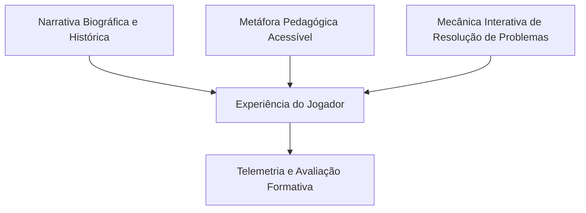

# O Projeto Pioneiras & Além: Documento Base para Artigo Científico

> **Referência Temática:** Serious Games, Educação em Computação, Mulheres na Ciência, Pensamento Computacional, ODS 5 (Igualdade de Gênero), Telemetria Educacional.  
> **Público-alvo de Publicação:** Conferências de Informática na Educação e Jogos (ex.: *Computer on the Beach - COTB*, *Simpósio Brasileiro de Informática na Educação - SBIE*, *Workshop sobre Educação em Computação - WEI/CSBC*, *Simpósio Brasileiro de Jogos e Entretenimento Digital - SBGames*).

---

## 1. Identificação e Resumo Executivo

* **Título do Trabalho Sugerido:**  
  *O Projeto Pioneiras & Além: Um Serious Game Narrativo para o Ensino de Fundamentos de Computação e Promoção da Equidade de Gênero (ODS 5)*
* **Autores:** Thiago Mendonça e colaboradores.
* **Resumo:**  
  Apesar de as mulheres terem desempenhado papéis fundacionais na gênese da Ciência da Computação, narrativas históricas dominantes e estereótipos contemporâneos continuam a afastar meninas e jovens das carreiras em Exatas e Tecnologia (STEM). Este trabalho apresenta **O Projeto Pioneiras & Além**, um *serious game* em plataforma web (Godot Engine) projetado para apresentar a história da computação sob a perspectiva de sete mulheres que transformaram o mundo digital: Ada Lovelace, as ENIAC Girls, Grace Hopper, Katherine Johnson, Mary Kenneth Keller, Margaret Hamilton e a brasileira Edith Ranzini. O jogo materializa conceitos fundamentais do Pensamento Computacional (algoritmos, arquitetura de computadores, depuração, compilação, modelagem numérica, linguagens interativas, tolerância a falhas e priorização de tarefas) em mecânicas interativas estruturadas por metáforas pedagógicas acessíveis. O artefato integra um subsistema de telemetria educacional com pré-teste, registro em tempo real de tempo despendido, contagem precisa de tentativas/erros por fase, verificação de leitura de cartões de síntese e questionário avaliativo pós-intervenção, fornecendo evidências empíricas para investigações sobre aprendizagem e percepção de autoeficácia.
* **Palavras-chave:** Jogos Educacionais; Mulheres na Computação; Pensamento Computacional; ODS 5; Telemetria Educacional; Godot Engine.

---

## 2. Introdução e Contextualização Social

### 2.1. O Apagamento Histórico e o Paradoxo de Gênero na Computação
Nos primórdios da computação moderna, a programação de computadores e o cálculo balístico eram amplamente executados por mulheres, então denominadas "computadores humanas". Com a consolidação da microinformática nas décadas de 1970 e 1980 e a consequente comercialização de computadores pessoais associados ao público masculino ("brinquedos de meninos"), observou-se uma queda acentuada na matrícula de mulheres nos cursos de Ciência e Engenharia da Computação no Brasil e no mundo.

Esse cenário produz um duplo problema:
1. **Desigualdade e barreira cultural:** Meninas e jovens não encontram modelos representativos femininos nos livros didáticos e na cultura popular sobre tecnologia.
2. **Perda de potencial de inovação:** A ausência de diversidade de gênero empobrece o desenvolvimento de algoritmos e sistemas computacionais modernos.

### 2.2. Alinhamento com a ODS 5 (Agenda 2030 da ONU)
O jogo alinha-se diretamente ao **Objetivo de Desenvolvimento Sustentável 5 (ODS 5 - Igualdade de Gênero)**, especificamente na meta de assegurar a participação plena e efetiva das mulheres e a igualdade de oportunidades de liderança em todos os níveis de tomada de decisão na vida econômica e pública, bem como no acesso às tecnologias de informação e comunicação (TIC).

Para evitar que a ODS 5 seja tratada como um mero rótulo abstrato, **O Projeto Pioneiras & Além** adota uma estratégia em duas frentes:
* **Nas Eras Históricas:** Foco nas barreiras sociais e preconceitos concretos que cada pioneira enfrentou em sua época para ter sua inteligência reconhecida.
* **No Tópico da ODS 5:** Foco na reflexão ativa sobre o cenário atual, conscientizando o jogador sobre a importância de políticas afirmativas, ambientes acolhedores e combate à disparidade de gênero na tecnologia contemporânea.

---

## 3. Metodologia de Design do Jogo

O artefato foi concebido sob a abordagem metodológica de **Design Centrado na Aprendizagem Significativa**, articulando três pilares:



1. **Narrativa em Diálogos Históricos:** Cada era inicia-se com a pioneira dialogando em primeira pessoa com o jogador, estabelecendo contexto histórico, motivação pessoal e a urgência do problema tecnológico de seu tempo.
2. **Princípio da Metáfora Pedagógica:** O conceito computacional abstrato nunca é apresentado como jargão hermético. Ele é traduzido em uma metáfora cotidiana que o estudante já compreende (ex.: a receita de bolo para algoritmos; o maestro para a CPU do ENIAC; a gaveta para variáveis em BASIC).
3. **Mecânica de Desafio Ativo:** O jogador não é um mero espectador passivo de animações. Para avançar no tempo, ele precisa manipular cartões, conectar circuitos, traduzir códigos, calibrar variáveis físicas ou gerenciar filas de processos sob sobrecarga.
4. **Cartão de Conquista e Síntese Teórica:** Ao concluir cada desafio, o jogo abre uma interface de síntese estruturada em abas pedagógicas:
   * *A Pioneira e as Barreiras Enfrentadas (ODS 5);*
   * *O Contexto Histórico da Invenção;*
   * *O Conceito Computacional Formal (o que a mecânica ensina).*

---

## 4. Detalhamento das Fases do Jogo

| Era / Fase | Pioneira(s) e Ano | Conceito de Computação | Metáfora Pedagógica | Mecânica de Jogo |
|---|---|---|---|---|
| **Era 1** | Ada Lovelace (1843) | Algoritmo, Sequenciamento, Estruturas de Controle (I/O, Processamento, Decisão) | **A Receita do Bolo da Máquina Analítica** | Ordenação de 4 cartões perfurados conceituais em slots sequenciais com feedback dedutivo imediato. |
| **Era 2** | ENIAC Girls (1945) | Arquitetura de Computadores, Fluxo de Dados e Circuitos Físicos | **O Maestro e os Painéis de Conexão** | *Patch panel* interativo: ligar o gerador de pulsos (ritmo), os acumuladores (cálculo) e a impressora (saída). |
| **Era 3** | Grace Hopper (1947) | Depuração (*Debugging*) e Compiladores (Linguagens de Alto Nível) | **A Caça ao Inseto Físico e o Tradutor Humano-Máquina** | Descoberta da mariposa nos relés eletromecânicos e associação de instruções humanas em inglês a microinstruções de máquina. |
| **Era 4** | Katherine Johnson (1962) | Modelagem Matemática, Parâmetros Críticos e Verificação Humana de Algoritmos | **O Corredor de Reentrada Atmosférica** | Ajuste fino de 3 parâmetros (ângulo de incidência, velocidade orbital e tempo de retrofoguetes) para resgate da Friendship 7. |
| **Era 5** | Irmã Mary Kenneth Keller (1965) | Democratização da Programação, Sintaxe Lógica, Variáveis e Interatividade | **Perguntar e Guardar na Gaveta** | Reorganização de linhas BASIC com botões de subir/descer e execução de um terminal interativo que lê o nome do jogador. |
| **Era 6** | Margaret Hamilton (1969) | Engenharia de Software, Concorrência, Priorização de Tarefas e Tolerância a Falhas | **A Triagem de Emergência do Alarme 1202** | Gerenciamento da sobrecarga da CPU do AGC (130% para <85%), descartando tarefas supérfluas e preservando sistemas de pouso. |
| **Epílogo** | Edith Ranzini (1972, Brasil) | Soberania Tecnológica, Hardware Nacional (*Patinho Feio*) e América Latina | **O Pioneirismo Brasileiro e a Descentralização da História** | Painel interativo de documentação histórica sobre o primeiro computador da USP e a importância da diversidade na ciência latino-americana. |

### 4.1. Era 1: Ada Lovelace (1843)
* **Objetivo Pedagógico:** Compreender que todo algoritmo requer uma sequência rigorosa de Entrada -> Processamento -> Decisão -> Saída.
* **Metáfora:** Preparar um bolo. Não se pode bater a massa sem ingredientes na tigela (Processar sem Entrada), nem servir o bolo sem antes testar com o palito se ele está assado (Saída sem Decisão).
* **Feedback:** Mensagens pedagógicas explicam exatamente o erro cometido de acordo com o cartão colocado fora de posição.

### 4.2. Era 2: ENIAC Girls (1945)
* **Objetivo Pedagógico:** Compreender que a computação nasceu como uma integração entre hardware físico e lógica pura, realizada manualmente pelas pioneiras (Kay McNulty, Betty Jennings, Betty Snyder, Marlyn Wescoff, Frances Bilas e Ruth Lichterman).
* **Metáfora:** Os circuitos como uma orquestra regida por um relógio central (*Master Programmer*).
* **Feedback:** Identificação funcional dos cabos de dados versus cabos de sincronismo e impressão.

### 4.3. Era 3: Grace Hopper (1947)
* **Objetivo Pedagógico:** Desmistificar a linguagem de máquina e compreender a invenção do compilador como uma ponte democrática entre o pensamento humano e os transistores.
* **Metáfora:** O compilador como um poliglota/tradutor simultâneo.
* **Feedback:** O jogador testa os relés físicos procurando o primeiro bug registrado e, em seguida, mapeia ordens do dia a dia para rotinas de baixo nível.

### 4.4. Era 4: Katherine Johnson (1962)
* **Objetivo Pedagógico:** Demonstrar que programas de computador precisam de parâmetros calibrados com precisão e que a verificação analítica humana é essencial em sistemas críticos de missão.
* **Metáfora:** Uma janela estreita na atmosfera terrestre pela qual uma cápsula espacial precisa passar sem ricochetear no espaço nem se desintegrar pelo atrito térmico.
* **Feedback:** Sliders com telemetria ao vivo e orientações de Katherine sobre a física da órbita da missão de John Glenn.

### 4.5. Era 5: Irmã Mary Kenneth Keller (1965)
* **Objetivo Pedagógico:** Ensinar o conceito de variáveis de memória e a sintaxe de linguagens de programação de alto nível (BASIC).
* **Metáfora:** A gaveta rotulada (`NOME$`) onde o computador armazena uma resposta digitada pelo usuário para utilizá-la em momentos posteriores da execução.
* **Feedback:** O jogador manipula comandos `REM`, `PRINT` e `INPUT`, testa o algoritmo e interage com o terminal digitando seu próprio nome e recebendo uma saudação personalizada gerada pelo código construído.

### 4.6. Era 6: Margaret Hamilton (1969)
* **Objetivo Pedagógico:** Compreender escalonamento assíncrono de processos, alocação de memória e robustez de software crítico (missão Apollo 11).
* **Metáfora:** A triagem de emergência de um hospital ou corpo de bombeiros em momentos de crise.
* **Feedback:** A barra de uso da CPU (130%) reduz à medida que processos secundários (ex.: radar de acoplamento comissionado erroneamente pelo radar de solo) são desativados, impedindo o jogador de desativar sistemas vitais (motores de descida e controle inercial).

### 4.7. Epílogo Especial: Edith Ranzini (1972, Brasil)
* **Objetivo Pedagógico:** Desconstruir a ideia de que a história da tecnologia ocorreu exclusivamente nos Estados Unidos e na Europa, valorizando o pioneirismo feminino e a soberania tecnológica brasileira e latino-americana.
* **Conteúdo:** A trajetória da Profa. Dra. Edith Ranzini na Escola Politécnica da USP, o projeto e montagem do minicomputador *Patinho Feio* (1971-1972) e seu legado na fundação da pós-graduação em Computação e na docência na PUC-SP.

---

## 5. Instrumentação de Pesquisa e Telemetria Educacional

Para viabilizar a publicação científica de artigos empíricos, o jogo incorpora um sistema de telemetria transparente e não-invasivo:

```
[Tela Inicial: Coleta de Consentimento, Nome e Cidade/UF]
                       │
                       ▼
[Sondagem Pré-Teste: Conhecimento de Pioneiras & Experiência Prévia em Programação]
                       │
                       ▼
[Fluxo das 6 Eras: Registro por Fase]
 ├── Tempo despendido (precisão decimal em segundos)
 ├── Contagem exata de tentativas/erros antes do sucesso
 └── Confirmação booleana de abertura e leitura do Cartão de Síntese
                       │
                       ▼
[Epílogo Especial: Acesso ao módulo brasileiro]
                       │
                       ▼
[Tela de Vitória & Pós-Teste]
 ├── Exibição do relatório consolidado de telemetria
 ├── Questionário Likert de percepção e autoeficácia pós-jogo
 └── Estrutura de dados exportável em JSON para tabulação estatística
```

### 5.1. Dicionário de Dados da Telemetria (JSON)
```json
{
  "timestamp": "2026-10-18T06:50:00",
  "player_name": "Nome do Participante",
  "player_city": "Florianópolis/SC",
  "player_score": 600,
  "pre_survey": {
    "conhecimento_previo_pioneiras": false,
    "ja_programou_antes": false
  },
  "stages_telemetry": {
    "ada": { "completed": true, "time_spent": 20.5, "attempts": 1, "read_synthesis": true },
    "eniac": { "completed": true, "time_spent": 13.2, "attempts": 1, "read_synthesis": true },
    "grace": { "completed": true, "time_spent": 27.7, "attempts": 1, "read_synthesis": true },
    "katherine": { "completed": true, "time_spent": 23.7, "attempts": 1, "read_synthesis": true },
    "keller": { "completed": true, "time_spent": 35.8, "attempts": 2, "read_synthesis": true },
    "margaret": { "completed": true, "time_spent": 45.9, "attempts": 1, "read_synthesis": true }
  },
  "edith_epilogue_viewed": true,
  "post_test_answers": {
    "compreendeu_relacao_moderna": true,
    "reconhece_importancia_ods5": true,
    "sentiu_interesse_computacao": true
  }
}
```

---

## 6. Arquitetura Técnica e Acessibilidade

* **Engine:** Godot Engine 4 (GDScript).
* **Compilação e Distribuição:** WebAssembly (Wasm) e HTML5 Canvas, permitindo execução fluida em qualquer navegador moderno (Chrome, Firefox, Safari, Edge) sem necessidade de instalação local.
* **Hospedagem e Escalabilidade:** Netlify CDN (`https://pioneirasealem.netlify.app/`), garantindo baixa latência e compatibilidade com feiras de ciências, salas de aula e eventos presenciais.
* **Tratamento de Tipografia e Ícones:**
  * Renderização nativa vetorial (SVG) para ícones de interface (botões de subida/descida, timelines, símbolos de acessibilidade).
  * Sanitização de caracteres Unicode para evitar artefatos de renderização (*tofu boxes*) em navegadores web.
  * Otimização de fontes TTF (*subpixel positioning* e *hinting*) para legibilidade em monitores com diferentes densidades de pixels.

---

## 7. Sugestão de Roteiro para Redação do Artigo Científico

Ao redigir o artigo para submissão a eventos acadêmicos, sugere-se a seguinte divisão em seções:

1. **Introdução:**
   * Apresentação da temática: mulheres na história da tecnologia e a ODS 5.
   * Justificativa pedagógica e social.
   * Questões de Pesquisa (Research Questions):
     * **QP1:** Como a utilização de metáforas pedagógicas em um sério jogo narrativo afeta a compreensão de conceitos do Pensamento Computacional por estudantes sem conhecimento prévio de programação?
     * **QP2:** Qual é o impacto da experiência interativa na percepção dos estudantes sobre o protagonismo histórico das mulheres na Ciência da Computação?
     * **QP3:** Como os dados de telemetria (tempo de resolução e tentativas de depuração) refletem a complexidade cognitiva de cada era histórica?
2. **Trabalhos Relacionados:**
   * Jogos sérios no ensino de computação (LightBot, CodeCombat, human-resource-machine).
   * Iniciativas de equidade de gênero na computação (Meninas Digitais - SBC, Girls Who Code).
   * Lacunas encontradas na literatura: ausência de jogos que unam biografia histórica fidedigna, metáforas conceituais ativas e representatividade latino-americana/brasileira.
3. **O Projeto Pioneiras & Além:**
   * Descrição das diretrizes de design, mecânicas por era e o papel do Cartão de Síntese.
   * Metáforas pedagógicas e alinhamento com a BNCC (pensamento computacional e cultura digital).
4. **Metodologia de Avaliação:**
   * Delineamento do estudo empírico com estudantes (público-alvo, procedimentos éticos, instrumento de coleta via telemetria integrada).
5. **Resultados e Discussão:**
   * Comparação do pré-teste com o pós-teste (ganho percentual de conhecimento e interesse).
   * Análise do tempo de resolução e número de tentativas por fase.
   * Evidências qualitativas colhidas sobre o impacto da história de Edith Ranzini e a ODS 5.
6. **Considerações Finais e Trabalhos Futuros:**
   * Síntese das contribuições do trabalho.
   * Potencial de aplicação em oficinas escolares e feiras de ciências.
   * Planos futuros: inclusão de novas pioneiras (ex.: Radia Perlman, Frances Allen, Carol Shaw).
